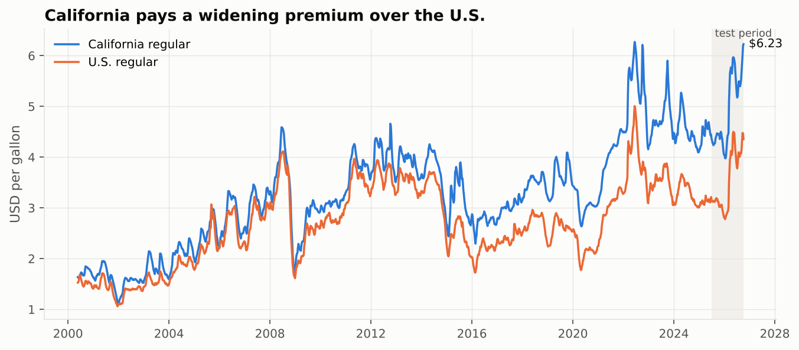

# Forecasting California Gasoline Prices

UCLA Anderson, Time Series Analysis and Forecasting (Dr. William Yu), group project, Fall 2026.

Weekly forecasts of California regular gasoline prices: conventional time-series models (naive, ETS, ARIMA, ARIMAX),
zero-shot time-series foundation models (Chronos-Bolt, Moirai 2.0) and Claude LLM experiments, evaluated on a July 2025 – October 2026
test period with 66 rolling origins at 4- and 12-week horizons, plus Granger/VAR and rockets-and-feathers analysis of crude pass-through.



## Headline results (66 weekly origins, MAE in USD/gal)

| Model | 4 weeks | skill vs naive | 12 weeks | skill vs naive |
|---|---|---|---|---|
| Naive (random walk) | 0.270 | 1.00 | 0.600 | 1.00 |
| ETS | 0.268 | 0.99 | 0.694 | 1.16 |
| ARIMA + Fourier | 0.217 | 0.80 | 0.412 | 0.69 |
| **ARIMAX (Brent + events)** | **0.213** | **0.79** | **0.397** | **0.66** |
| ARIMAX without latest crude week (robustness) | 0.218 | 0.81 | 0.410 | 0.68 |
| Chronos-Bolt (zero-shot) | 0.277 | 1.03 | 0.579 | 0.97 |
| Moirai 2.0 (zero-shot) | 0.279 | 1.03 | 0.639 | 1.07 |
| Combination (ARIMAX + Chronos-Bolt) | 0.237 | 0.88 | 0.467 | 0.78 |

The Claude forecasts were scored only on the 16 dates they ran on, so they are compared by skill on those dates:

| Claude | 4 weeks skill | 12 weeks skill |
|---|---|---|
| Full context (named series, dates, market brief) | 0.85 | 0.77 |
| Anonymized (index only) | 1.04 | 0.92 |

**Takeaways**
- ARIMA-type models beat the naive forecast by about 20% at 4 weeks and about 31–34% at 12 weeks. At 4 weeks the gain is significant only at the 10% level (Diebold–Mariano p ≈ 0.05–0.08). At 12 weeks it is not significant.
- The zero-shot foundation models only tie the naive forecast. ARIMAX beats them at 4 weeks (DM p ≈ 0.01–0.03).
- Claude given full context comes close to ARIMA. The anonymized version does no better than naive. The gap (0.05 at 4 weeks, 0.10 at 12 weeks) says the LLM's edge comes from context and background knowledge, not from pattern recognition. Claude's training data reaches into mid-2026, which overlaps the test period, so the full-context edge is partly memory. On the 3 origins after June 2026, both Claude versions are worse than naive at 4 weeks.
- Crude leads the pump by 0–2 weeks. Brent Granger-causes California gasoline (p < 0.001); the reverse does not hold. A 10% Brent shock lifts California prices about 5.3% after 4 weeks and about 6.5% after 12 weeks (VAR).
- Rockets and feathers: total pass-through is the same for crude increases and decreases (about $1.10 vs $1.01 per $1, p = 0.59). Increases arrive faster, though: in the first week about 0.49 of an increase reaches the pump versus 0.25 of a decrease (p = 0.06).

## Method notes worth knowing

- **Most recent crude week matters.** Weekly Brent is already the previous week's average (known on the Monday the pump price is collected). Using crude lags 0–3 gives ARIMAX its edge over ARIMA; using lags 1–4 removes it (`arimax_lags1to4`).
- **Cointegration needs a trend.** California's premium over crude rises for 25 years: P and C are not cointegrated around a constant (Engle–Granger p = 0.89) but are around a trend (p = 0.001), so the ECM's long-run relation includes a trend.
- **"Faster" is about speed.** Total pass-through is tested (Σβ⁺ = Σβ⁻) alongside first-week and first-two-week pass-through; only the speed tests show the asymmetry.
- **Interval calibration.** The naive 80% interval uses empirical h-week changes (79% coverage at 4 weeks); a normal σ√h interval would cover only about 64% because weekly changes are autocorrelated (lag-1 ACF 0.64).
- **Diebold–Mariano.** HLN small-sample correction with a Newey–West (Bartlett) long-run variance, which stays positive with ~55 overlapping 12-week forecasts.

## Repository layout

```
data/
  raw/                  downloaded source files (FRED CSV, EIA XLS)
  weekly_data.csv       one row per EIA Monday: prices, crude, West Coast supply, event dummies, train/test split
  data_dictionary.csv   column definitions and sources
  events.csv            event calendar with sources
notebooks/
  01_data_pull.ipynb            download and align data (no API key needed)
  02_eda.ipynb                  prices, spread, STL seasonality, ADF/KPSS, ACF/PACF, cross-correlation
  03_backtest_conventional.ipynb  rolling-origin backtest: naive, seasonal naive, ETS, ARIMA+Fourier, ARIMAX
  04_econometrics.ipynb         VAR, Granger, impulse response, rockets-and-feathers ECM
  05_foundation_models.ipynb    Chronos-Bolt and Moirai 2.0, zero-shot
  06_llm_experiments.ipynb      Claude: anonymized vs full-context experiments
  07_evaluation.ipynb           metrics, Diebold–Mariano, combination, robustness
src/
  common.py                backtest loop, forecast file format, metrics, DM test
  models_conventional.py   conventional models
  models_foundation.py     foundation-model wrappers (local weights)
  llm_prompts.py           prompt construction and response parsing
  plots.py                 shared chart style
  build/                   scripts that generate the notebooks
forecasts/                 every model's forecasts in the shared format
results/
  metrics.csv, dm_tests.csv, rockets_feathers.csv, llm_same_dates.csv, ...
  figures/                 all charts
  llm/prompts/             every prompt sent to Claude
  llm/responses.jsonl      every raw Claude reply (model, timestamp)
```

**Forecast file format** (every model): `model, origin_date, horizon, target_date, forecast, lower80, upper80`, in USD/gal.

## How to run

```bash
pip install -r requirements.txt
jupyter lab            # run notebooks 01 → 07 in order
```

- **Data:** `01_data_pull.ipynb` reads the files in `data/raw/`. Set `REFRESH = True` to download fresh copies from FRED and EIA; no keys are needed.
- **Foundation models:** the weights are not in the repo because they exceed GitHub's file limit. Download them into `models/`:
  - `amazon/chronos-bolt-small` → `models/chronos-bolt-small/`
  - `Salesforce/moirai-2.0-R-small` → `models/moirai-2.0-R-small/`
  
  For example: `huggingface-cli download amazon/chronos-bolt-small --local-dir models/chronos-bolt-small`.
- **LLM experiments:** the logged replies are included, so notebook 06 runs without a key. To regenerate them, set `ANTHROPIC_API_KEY` and call `llm_api_run()` at the end of the notebook.

## Design notes

- **No look-ahead.**
  - Retail gasoline is surveyed on Monday mornings, so crude enters as the average of the previous Monday–Friday.
  - West Coast supply data enters only after its Wednesday release.
  - ARIMAX assumes future crude follows a random walk.
  - Event dummies are held at their value on the origin date.
- **Test period.** It includes the 2026 Iran-war crude shock (Brent rose from about $64 to $125) and two California refinery closures, so results describe a turbulent period.
- **Changes from the proposal.**
  - Moirai 2.0 replaces TimesFM: the TimesFM checkpoint was too large for this environment.
  - ChatGPT was not run.
  - LLM forecasts use 2 repeats per prompt instead of 3.
  - The full-context prompt uses a market brief built only from data, not news text.

## AI tools used

Claude (Anthropic) wrote and ran the code in this repository, pulled the data through a browser, and produced the Claude forecasts. Each forecast came from a fresh Claude Opus 5.5 session limited to reading one prompt file. Every prompt and raw reply is logged in `results/llm/`.
